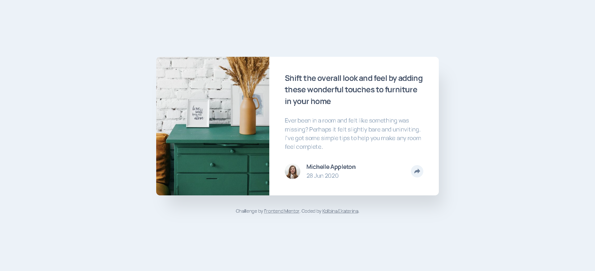
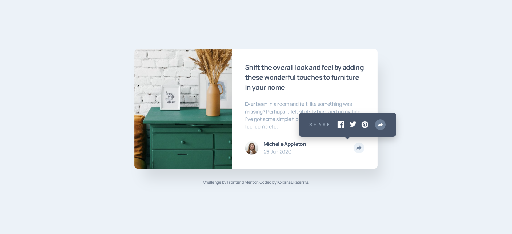
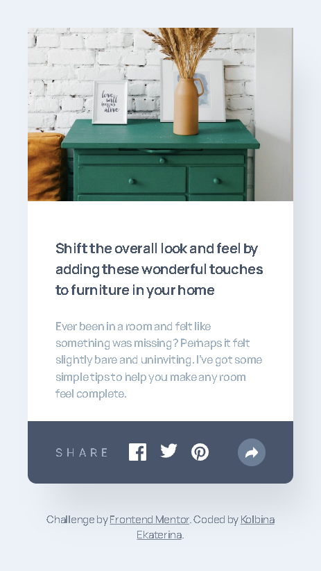
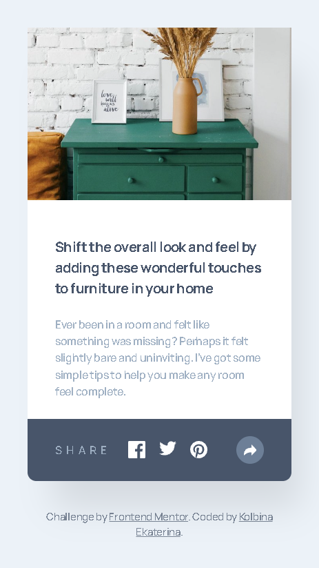

# Frontend Mentor - Article preview component solution

This is a solution to the [Article preview component challenge on Frontend Mentor](https://www.frontendmentor.io/challenges/article-preview-component-master). Frontend Mentor challenges help you improve your coding skills by building realistic projects.

## Table of contents

- [Overview](#overview)
  - [The challenge](#the-challenge)
  - [Screenshot](#screenshot)
  - [Links](#links)
- [My process](#my-process)
  - [Built with](#built-with)
  - [What I learned](#what-i-learned)
- [Author](#author)
- [Acknowledgments](#acknowledgments)

## Overview

### The challenge

Users should be able to:

- View the optimal layout for the component depending on their device's screen size
- See the social media share links when they click the share icon
- See hover states for all interactive elements on the page

### Screenshot

| Desktop | Desktop (Share Menu Open) |
| :---: | :---: |
|  |  |

| Mobile | Mobile (Share Menu Open) |
| :---: | :---: |
|  |  |

### Links

- Solution URL: [https://github.com/Ekaterina-alekse/article-preview-component](https://github.com/Ekaterina-alekse/article-preview-component)
- Live Site URL: [https://ekaterina-alekse.github.io/article-preview-component/](https://ekaterina-alekse.github.io/article-preview-component/)

## My process

### Built with

- Semantic HTML5 markup
- CSS custom properties
- Flexbox
- Mobile-first workflow
- JavaScript (DOM manipulation)
- BEM methodology

### What I learned

In this project, I practiced:

- **JavaScript DOM manipulation** — toggling the share menu visibility and updating `aria-expanded` attribute for accessibility
- **BEM methodology** — using clear and structured class names
- **Accessibility** — using `aria-label`, `aria-expanded`, and `hidden` attributes properly
- **Mobile-first workflow** — starting with mobile styles and adding desktop via media queries
- **CSS positioning** — creating a tooltip-style share menu with a decorative arrow on desktop

## Author

- GitHub - [Ekaterina-alekse](https://github.com/Ekaterina-alekse)
- Frontend Mentor - [@Ekaterina-alekse](https://www.frontendmentor.io/profile/Ekaterina-alekse)

## Acknowledgments

Thanks to Frontend Mentor for providing this challenge and helping developers improve their skills through realistic projects.

---

---

# Решение задачи Frontend Mentor - Компонент предварительного просмотра статьи

Это решение задачи [Article preview component challenge on Frontend Mentor](https://www.frontendmentor.io/challenges/article-preview-component-master). Задачи Frontend Mentor помогают улучшать навыки программирования, создавая реалистичные проекты.

## Обзор

### Задача

Пользователи должны уметь:

- Видеть оптимальный макет в зависимости от размера экрана
- Видеть ссылки для публикации в социальных сетях при нажатии на иконку «Поделиться»
- Видеть состояния при наведении для всех интерактивных элементов

### Скриншоты

| Десктоп | Десктоп (меню открыто) |
| :---: | :---: |
|  |  |

| Мобильный | Мобильный (меню открыто) |
| :---: | :---: |
|  |  |

### Ссылки

- Репозиторий: [https://github.com/Ekaterina-alekse/article-preview-component](https://github.com/Ekaterina-alekse/article-preview-component)
- Живая версия: [https://ekaterina-alekse.github.io/article-preview-component/](https://ekaterina-alekse.github.io/article-preview-component/)

## Мой процесс

### Использованные технологии

- Семантическая разметка HTML5
- CSS-переменные
- Flexbox
- Mobile-first подход
- JavaScript (работа с DOM)
- Методология БЭМ

### Что я узнала

В этом проекте я применила:

- **Работу с DOM в JavaScript** — переключение видимости меню «Поделиться» и обновление атрибута `aria-expanded` для доступности
- **Методологию БЭМ** — чистые и структурированные имена классов
- **Доступность** — использование `aria-label`, `aria-expanded` и атрибута `hidden`
- **Mobile-first подход** — от мобильной версии к десктопной через медиа-запросы
- **CSS-позиционирование** — создание всплывающего меню со стрелочкой на десктопе

## Автор

- GitHub - [Ekaterina-alekse](https://github.com/Ekaterina-alekse)
- Frontend Mentor - [@Ekaterina-alekse](https://www.frontendmentor.io/profile/Ekaterina-alekse)

## Благодарности

Спасибо Frontend Mentor за этот челлендж и возможность улучшать свои навыки через реалистичные проекты.